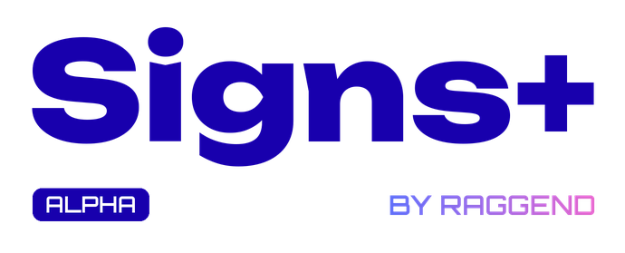
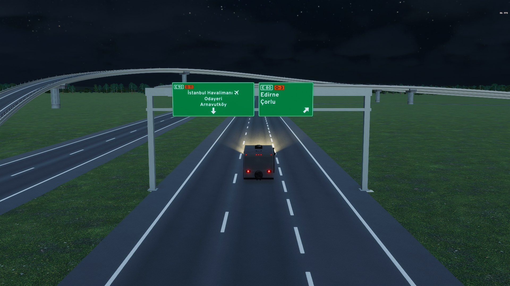
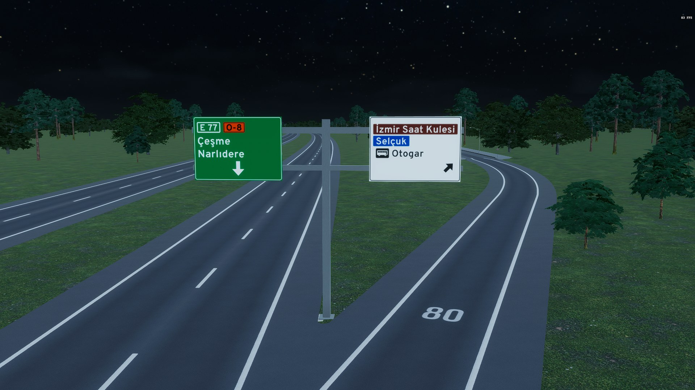
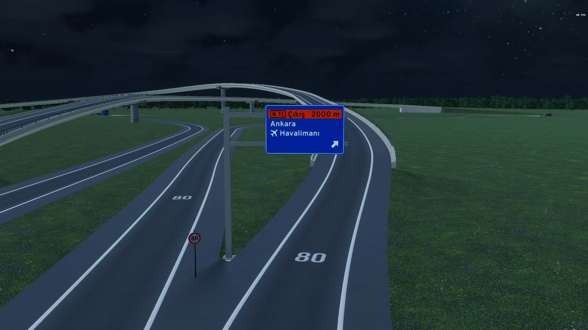
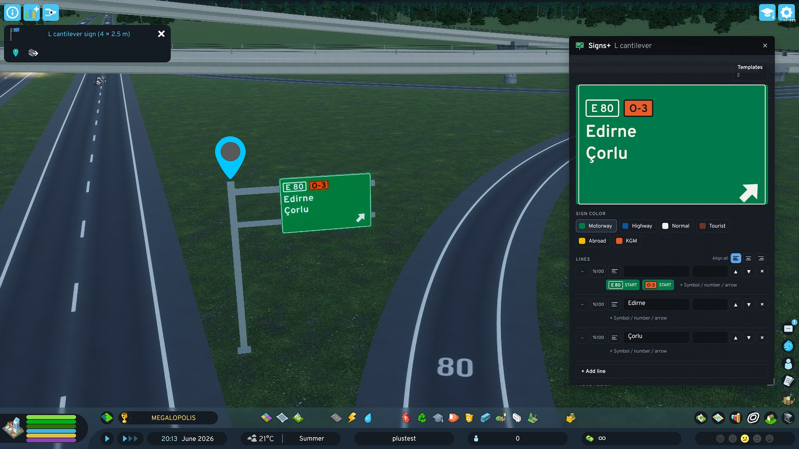
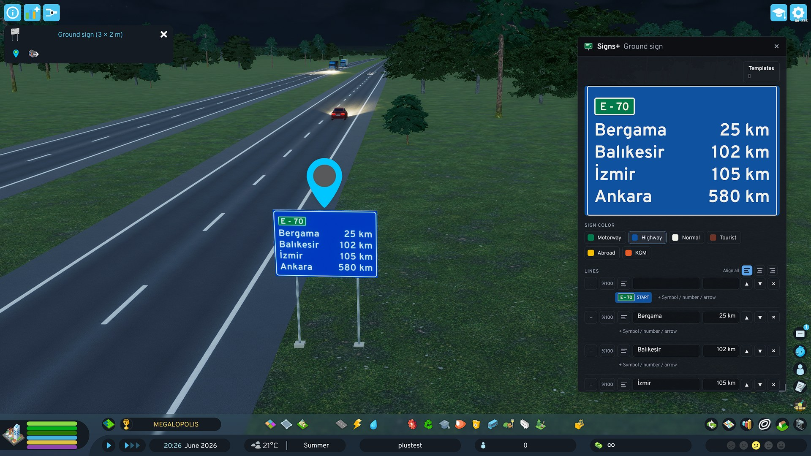
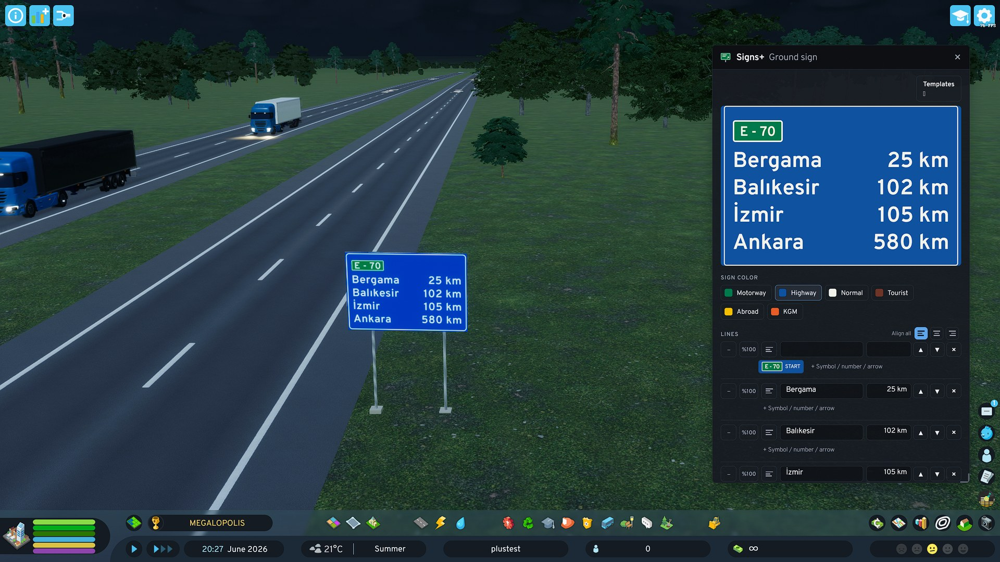
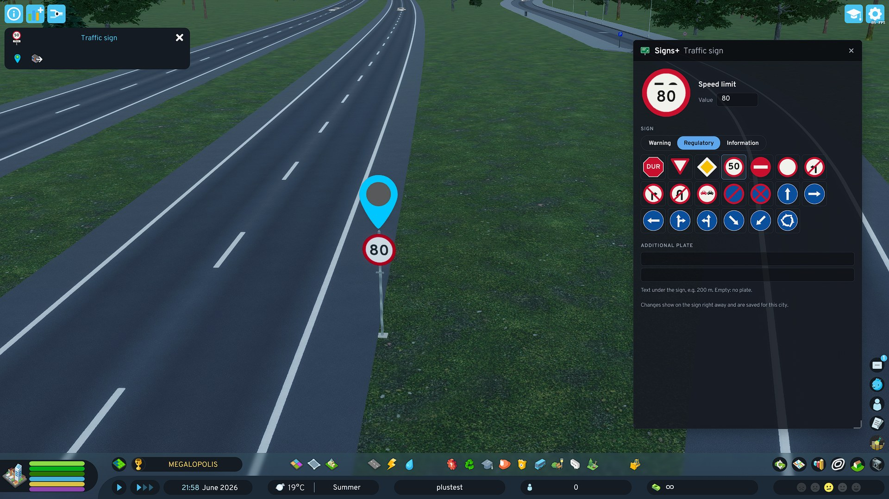

# Signs+ [ALPHA]

Design your own road signs in **Cities: Skylines II**. Place a sign, click it, and write it in a simple, Canva-style editor:
the sign in your city changes right away.

Turkish signs are the first country pack. **German signs are coming soon.**

Available on Paradox Mods: search for **"Signs+ [ALPHA]"**. Feedback and bug reports: the Issues tab of this repository
or the comments on Paradox Mods.

## Features

**Five signs, built from scratch**
- Overhead gantry with two panels
- L cantilever and T pole (left and right panels)
- Ground sign
- Traffic sign pole with an optional additional plate

**The editor**
- Templates: motorway, junction, distance, city, tourist and border signs
- Sign colours: motorway (green), highway (blue), normal (white), tourist (brown), border (yellow) and KGM (orange)
- Lines with their own block colour, text size and alignment (left, centre, right)
- Road number boxes (O, E, D, K: the colour comes from the first letter), 23 symbols, inline arrows and big arrows in 8 directions
- Right-aligned distances such as `Bergama ... 25 km`
- Copy one panel to the other, clear, undo

**Traffic signs**
- 37 standard signs: warning, regulatory and information
- Speed limits with any value, plus up to two lines on a plate below the sign

**Free placement**
- Signs+ signs can be placed on roads, sidewalks and other objects without an overlap error, roads can be built past them,
  and roads never remove them.
- Only Signs+ signs are affected. The game's global error settings are never touched, so it works the same with or
  without [Anarchy](https://github.com/yenyang/Anarchy). Can be switched off in the options.

## Screenshots

| | |
| --- | --- |
|  |  |
|  |  |
|  |  |

## How to use

- The signs are in the **Signs+** tab of the Roads menu.
- Click a placed sign to open the editor, or hover over one and press **Shift + L**.
- Traffic signs: place the traffic sign pole, click it, pick a group and a sign, type a value for speed limits.

## Saves and compatibility

- The sign texts are stored in a small file per city
  (`%USERPROFILE%\AppData\LocalLow\Colossal Order\Cities Skylines II\ModsData\SignsPlus\<city name>.txt`),
  not in your savegame. Removing the mod does not break your city; the signs just become blank.
- No Harmony patches. Signs+ draws its own sign textures and does not need Write Everywhere.
- The five sign models come in the Signs+ asset package, which Paradox Mods installs together with the mod.

## Coming soon

- German road signs
- More countries, more sign shapes and more symbols

## Source layout

| Path | What |
| --- | --- |
| `Rendering/SignComposer.cs` | Lays out and draws the text, symbols, number boxes and arrows of a panel |
| `Rendering/StandardSigns.cs`, `Rendering/SymbolLibrary.cs` | Standard sign and symbol libraries (vector shapes) |
| `Rendering/SignRasterizer.cs`, `Rendering/FontAtlas.cs` | Anti-aliased rasterizer and font atlases |
| `Systems/SignRenderSystem.cs` | Finds Signs+ signs in the city and puts the drawn textures on their panels |
| `Systems/SignPlacementSystem.cs` | Free placement |
| `Systems/SignsPlusUISystem.cs` | Bridge to the editor window |
| `Systems/SignToolbarSystem.cs` | The Signs+ toolbar tab |
| `Data/` | Sign store and panel definitions |
| `UI/` | Editor window (React), symbol and sign images |
| `Resources/` | Font atlases (Overpass, SIL OFL 1.1), symbol and standard sign data |
| `tools/` | Python generators for the assets, fonts, symbols and signs; offline test stubs |
| `NOTES.md` | Development notes (Turkish) |

## Building

Requires the Cities: Skylines II modding toolchain (installed from the game's Options → Modding) and Node.js.
Close the game and run `build.bat`. It builds the editor window and the mod and copies them into the game's local mods folder.

## License

Source available, **all rights reserved**. You may read and build the code for personal use and send issues or pull requests,
but you may not copy, reuse or republish it. See [LICENSE](LICENSE).
The Overpass font is licensed separately under the SIL Open Font License 1.1 (`Resources/OFL-Overpass.txt`).
