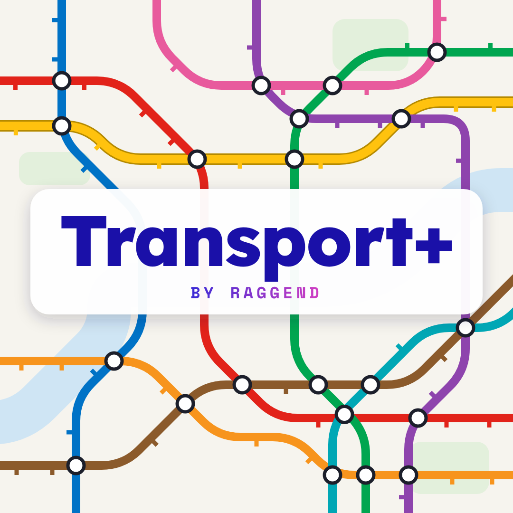
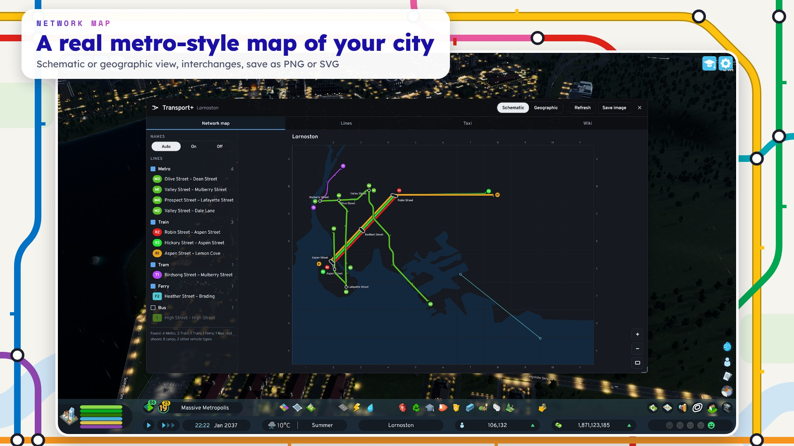
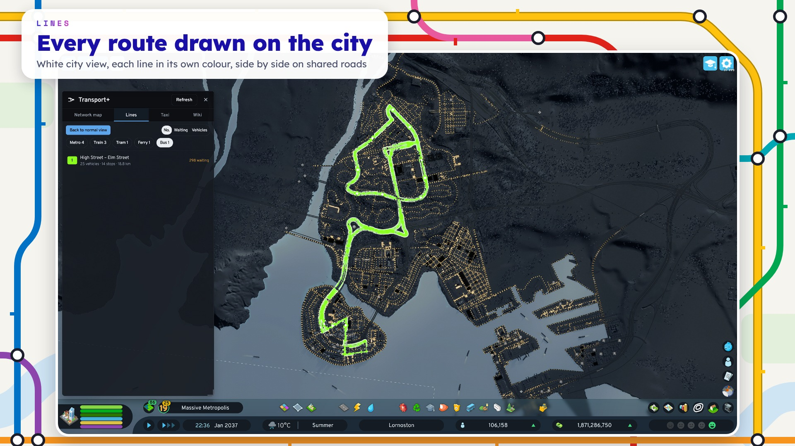
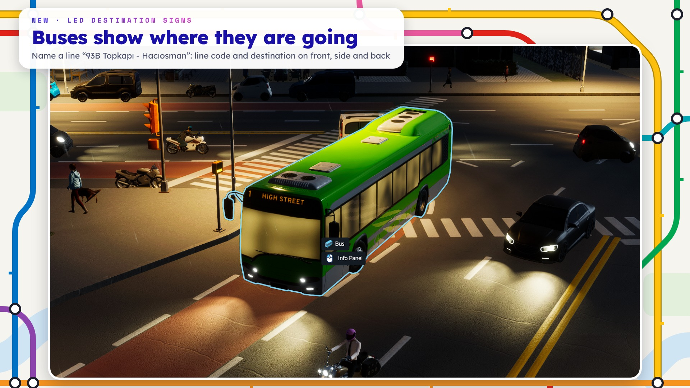

<p align="center"></p>

# Transport+ by Raggend

A real metro-style map of your public transport network for **Cities: Skylines II**, routes drawn on the city itself,
and one panel to run every line, vehicle, stop, taxi and intercity bus.

Available on Paradox Mods: search for **"Transport+ by Raggend"** (Mod ID 166323).
Feedback and bug reports: [forum thread](https://forum.paradoxplaza.com/forum/threads/metro-and-train-mapping-in-cities-skylines-2.1948622/) or the Issues tab of this repository.

<p align="center"></p>
<p align="center"> </p>

## Features

**Network map**
- Metro, train, tram, ferry (and optionally bus) lines on one map with line colours and badges
- Schematic view (45° lines, tidy spacing, real-world order kept) or geographic view
- Interchanges, parallel lines on shared track, transfer links, sea and rivers from the game's water
- Save as PNG or SVG with a legend

**Lines**
- Routes drawn on the city like the game's traffic view: white city, every route in its own colour, side by side on shared roads
- Ticket price, number of vehicles and departure interval, day / night service, in / out of service
- Vehicle models for every line type (bus, tram, metro, train carriages and locomotive, ferry), including region packs and Paradox Mods assets
- Show vehicles on the map with model, passengers, next stop and speed; follow one with the game's own panel
- Stop statistics: waiting passengers, average wait, boarded and alighted per stop

**LED destination signs**
- Buses show their line on LED signs: code and destination on the front and side, code on the back
- Name a line like `93B Topkapı Hacıosman` or `15F Kadıköy - Beykoz Kavağı`: the first word with a digit is the code, the rest are the two ends.
  The sign shows the end the bus is heading to, and "NOT IN SERVICE" when it goes back to the depot

**Taxi**
- Block taxis from outside the city, starting fee (the game's city policy), own per-km and night fares
- Choose which taxi models are used; busiest taxi stands

**Intercity buses**
- Give buses that come from outside the city their own models, separate from city buses

**Wiki**
- A Wiki tab in the window explains every feature, with a button that opens the right tab

Open it with the button at the top left or **Shift + T**. The tabs are Network map, Lines, Taxi and **Wiki**, an in-game guide to every feature.

## Compatibility

- Works through the game's own systems: line settings use the game's policies, vehicle models use the game's own model list,
  the starting fee is the game's city policy. No Harmony patches.
- Routes and LED signs are drawn as extra overlays; the game's own rendering is not changed.
- Taxi and intercity model filters and the outside-taxi switch only change vehicle data while the game runs and are not saved,
  so the mod can be removed at any time.
- Every part loads on its own: if one feature runs into another mod, the menu, button and shortcut still work and the reason is written to `TransportPlus.Mod.log`.

## Source layout

| Path | What |
| --- | --- |
| `Mod.cs`, `Setting.cs`, `Locale.cs` | Loading, options, English and Turkish texts |
| `Systems/TransitMapUISystem.cs`, `TransitExporter.cs` | Menu, network map and route data for the UI |
| `Systems/RouteOverlaySystem.cs` | Routes and vehicles drawn on the city, white city info view |
| `Systems/LineManagerSystem.cs`, `VehicleCatalog.cs` | Line settings, vehicle models, vehicles and stop statistics |
| `Systems/DestinationSignSystem.cs`, `LineNames.cs`, `Rendering/` | LED destination signs on buses |
| `Systems/TaxiCoachSystem.cs`, `TaxiFareSystem.cs` | Taxi tab, fares and intercity bus models |
| `Systems/SvgRaster.cs`, `WaterContours.cs` | PNG export and water outlines |
| `UI/` | Window, tabs, in-game wiki (`UI/src/WikiTab.tsx`) and map drawing (React, built with esbuild) |

## Building

Requires the Cities: Skylines II modding toolchain (installed from the game's Options → Modding) and Node.js.

```
build.bat
```

`env.bat` finds the game folder (Xbox / Game Pass versions move it on every update). The build copies the mod into the
game's local mods folder and writes `build.log`. Close the game first.

## License

Source available, **all rights reserved**. You may read and build the code for personal use and send issues or pull requests,
but you may not copy, reuse or republish it. See [LICENSE](LICENSE). The font atlas is made from Overpass (SIL OFL 1.1).
